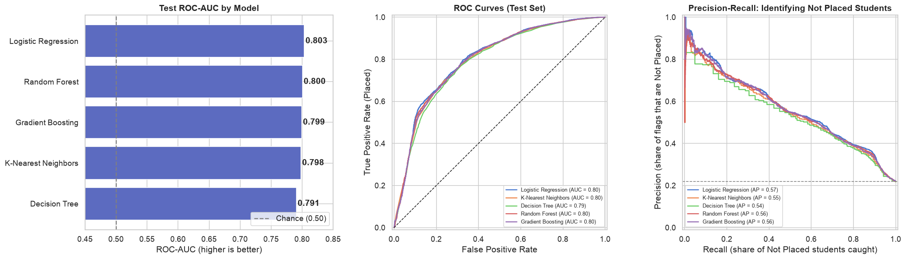
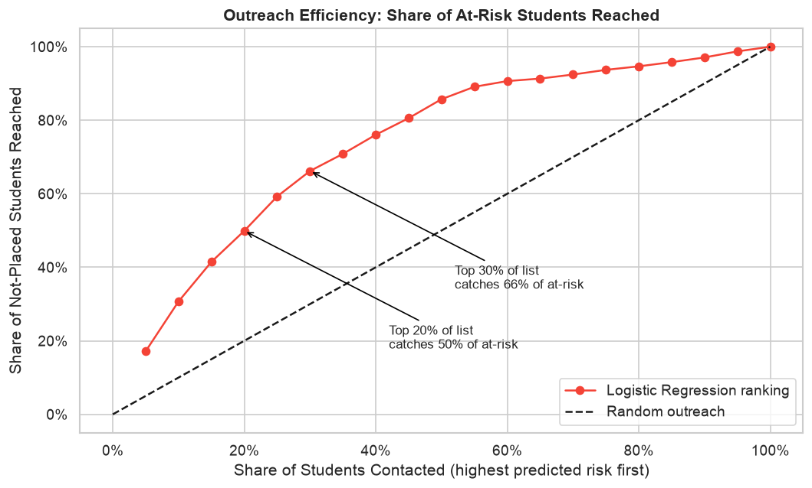
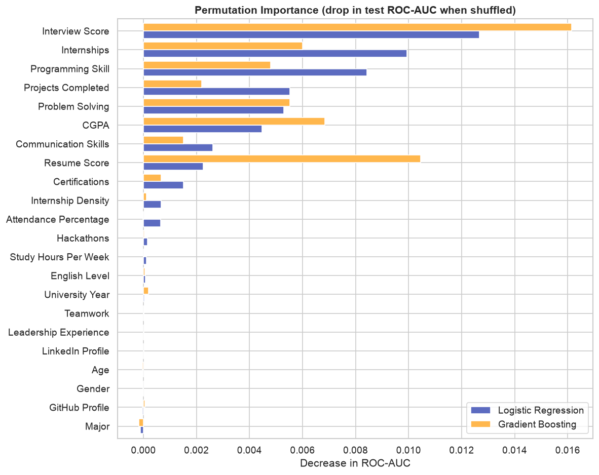
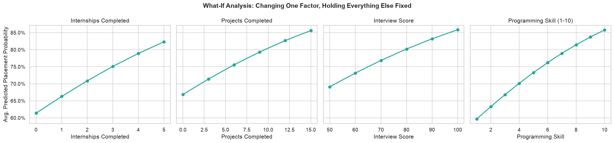
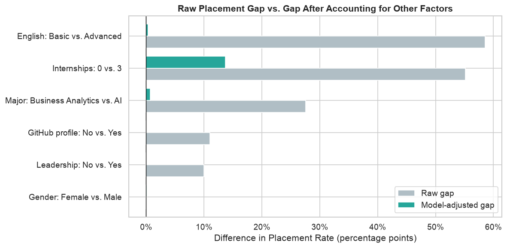

# Predicting Student Career Success After Graduation

**Author:** Jun Tie

**Jupyter Notebook:** [capstone_final.ipynb](capstone_final.ipynb)

---

## Executive Summary

Using records for 50,000 students, I built a model that predicts whether a student will land a job after graduation, using only information available while the student is still in school. The model is useful for prioritizing: if a career-services office contacts the 20% of students the model rates as highest-risk, it reaches half of all students who will end up without a job. That is 2.5 times more efficient than contacting students at random.

The analysis also shows what actually makes a difference. Interview performance, programming skill, internships, completed projects, and GPA are the strongest drivers. Several factors that look important at first glance — English proficiency, choice of major, having a GitHub profile, leadership roles — turn out to matter mainly because they go hand in hand with those core skills. Gender has no effect.

## Rationale

Career-services teams have limited time, and the students most at risk of graduating without a job are often the least likely to ask for help. Students, meanwhile, get generic advice ("get good grades, do internships") with no sense of which actions matter most. A data-driven early-warning list and a ranked set of levers would let schools reach at-risk students sooner and help students spend their effort where it counts.

## Research Question

Can measurable college-experience factors — academic performance, internships, projects, skills, and certifications — predict whether a student will be placed in a job after graduation? And which of these factors carries the most weight?

## Data Sources

**[Student Career Success Prediction Dataset (Kaggle)](https://www.kaggle.com/datasets/mobeenfatimah/student-career-success-prediction-dataset)**, stored in `data/student_career_success_dataset.csv`:

- 50,000 students, 29 columns: demographics, GPA, attendance, study hours, programming and soft-skill ratings, projects, certifications, hackathons, internships, GitHub/LinkedIn presence, resume and interview scores, and placement outcomes.
- 78% of students were placed and 22% were not.
- The data was already clean: no missing values and no duplicates. Unusual values were rare (under 1%) and realistic, so nothing was removed.

## Methodology

1. **Data cleaning and preparation:** checked data quality, created a Placed / Not Placed target, encoded Yes/No and ordered categories, and added an *internship density* feature (internships per semester).
2. **Avoiding "cheating" features:** removed columns that are only known *after* placement (company tier, career field, salary, placement mode) and an opaque "employability score," so the model uses only information a school would have in advance.
3. **Exploratory analysis and significance testing:** compared placement rates across every factor and checked correlations. Each gap was tested for statistical significance (chi-square tests for categories, t-tests for numeric factors, with a correction for running many tests at once). Effect sizes were reported alongside, since with 50,000 students even trivial differences can come out "significant."
4. **Modeling:** trained and compared six approaches — a do-nothing baseline, Logistic Regression, K-Nearest Neighbors, Decision Tree, Random Forest, and Gradient Boosting. Each was tuned with **grid search and 5-fold cross-validation** on 80% of the data. The remaining 20% was held back as a final test.
5. **Evaluation metric:** **ROC-AUC**, which measures how well the model *ranks* students from most to least likely to be placed (0.5 = coin flip, 1.0 = perfect). Ranking is what an advisor's priority list needs, and unlike accuracy, ROC-AUC isn't fooled by the fact that most students are placed. Recall (the share of at-risk students caught) and F1 were also tracked.
6. **Uncertainty:** 95% confidence intervals for each model's score, computed by bootstrapping (re-scoring the models on 1,000 resampled versions of the test set).
7. **Interpretation:** permutation importance, odds ratios, and "what-if" scenarios that change one factor at a time while holding everything else fixed.

## Results

### 1. The model reliably flags at-risk students

| Model | Test ROC-AUC | 95% confidence interval | At-risk students caught (recall) |
|---|---|---|---|
| **Logistic Regression (selected)** | **0.803** | 0.792 – 0.814 | **71%** |
| Random Forest | 0.800 | 0.790 – 0.811 | 71% |
| Gradient Boosting | 0.799 | 0.788 – 0.810 | 72% |
| K-Nearest Neighbors | 0.798 | 0.787 – 0.808 | 31% |
| Decision Tree | 0.791 | 0.779 – 0.801 | 72% |
| Baseline ("everyone gets placed") | 0.500 | — | 0% |



All the serious models land at about 0.80, well above chance. The simplest one, Logistic Regression, scores slightly *higher* than the complex ones. A paired statistical test confirms the edge is real (p < 0.01), but at 0.003–0.004 it's far too small to matter in practice. Logistic Regression was selected because it is at least as accurate and much easier to explain, and its results translate directly into advice. The baseline looks 78% "accurate" but never identifies a single at-risk student, which is why accuracy is not the yardstick here.

### 2. A short outreach list reaches most at-risk students



| Students contacted (highest risk first) | At-risk students reached |
|---|---|
| Top 10% | 31% |
| Top 20% | 50% |
| Top 30% | 66% |
| Top 50% | 86% |

### 3. What drives placement



The five strongest factors are **interview score, internships, programming skill, projects completed, and GPA**, followed by problem-solving and communication skills. All five differ significantly between placed and not-placed students (p < 0.001), with medium-to-large effect sizes. For example, placed students' interview scores are about one standard deviation higher.

Changing one factor while holding everything else fixed, the model's average predicted placement rate moves as follows:

| Change | Predicted placement |
|---|---|
| Programming skill 1 → 10 | 60% → 86% |
| Interview score 50 → 100 | 69% → 86% |
| Projects completed 0 → 15 | 67% → 86% |
| Internships 0 → 5 | 61% → 82% |



### 4. Some big gaps are proxies, not causes



In the raw data, students with Advanced English are placed far more often than students with Basic English (84% vs. 25%), and AI majors are placed far more often than Business Analytics majors (87% vs. 59%). But once the model accounts for interview scores, skills, and experience, these gaps almost disappear (under 1 point). For example, students with Basic English average an interview score of about 53, compared with about 80 for Advanced speakers, and that difference is where they lose ground. GitHub profiles and leadership roles follow the same pattern. LinkedIn profiles, attendance, hackathons, and age make essentially no difference. Study hours show only a small difference on their own, and none once other factors are known. Gender has no effect: Female, Male, and Other students are all placed at about 78%, and a chi-square test finds no significant difference (p = 0.90).

### Recommendations

- **Career services:** Score students each term and proactively contact the highest-risk 20–30%. That list reaches half to two-thirds of the students who would otherwise graduate without a job. Focus that outreach on internship placement, mock interviews, and technical-skill and project support.
- **Students:** Put your energy into internships, interview practice, and hands-on projects that build programming skill. These have the largest effect. Grades matter, but less.
- **Programs with lower placement rates (e.g., Business Analytics, Electrical Engineering):** The gap comes from students' skills and experience, not the major itself. Build internship pipelines and technical and interview preparation into those programs.
- **Students still building English proficiency:** Target interview and communication coaching, since interviews are where the gap shows up.

### Limitations

- The dataset is a public Kaggle dataset of unknown origin and may be synthetic. Findings should be confirmed on a school's own records before acting on them.
- The results show associations, not proven cause and effect.
- The model misses about 29% of at-risk students at its default setting, and more than half of the students it flags end up placed. It should guide where advisors start, not decide who receives help.

## Next Steps

- Validate the model on real institutional data, training on past graduating classes and testing on the most recent one.
- Add information the dataset lacks, such as internship timing, employer networking, and local job-market conditions.
- Predict starting salary for placed students as a follow-up question.
- Calibrate the risk scores and set the outreach cutoff to match actual advising capacity.
- Monitor fairness across gender, major, and other groups after deployment.

## Outline of Project

- [capstone_final.ipynb](capstone_final.ipynb) — the full analysis: data cleaning, feature engineering, exploratory analysis, model training and tuning, evaluation, interpretation, and findings.

```
├── README.md                 # This report
├── capstone_final.ipynb      # Technical notebook
├── data/
│   └── student_career_success_dataset.csv
└── images/                   # Figures used in this README
```

## Contact and Further Information

Jun Tie — [GitHub](https://github.com/jtie)
